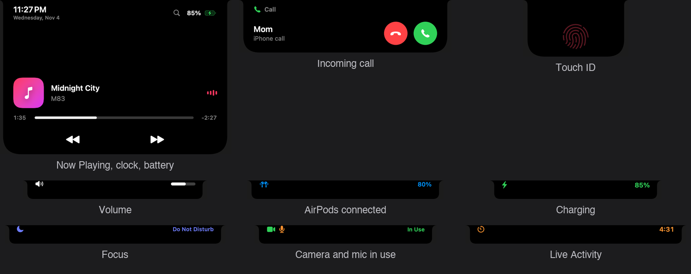

# MacBook Dynamic Island

A Dynamic Island for the MacBook notch, built with SwiftUI and AppKit. It sits over the notch, grows out of it on hover, and shows system activity the way the iPhone island does.

> Independent project. Not affiliated with or endorsed by Apple.




If you find it useful, a star helps other people discover it.

## Features

- **Expanded panel** (hover the notch): time and date, battery, Now Playing (Apple Music / Spotify) with artwork, progress and controls, and Live Activities.
- **Live HUDs**: volume, brightness, Focus / Do Not Disturb, Low Power Mode, Caps Lock, Bluetooth connect (with battery), audio output switch, camera / microphone in use, charging and low battery.
- **Touch ID prompt**: a drop-down card that mirrors the system sheet. A dim red fingerprint brightens, its ridges break away until only the ring is left, then the ring turns blue and draws a checkmark.
- **Calls and AirDrop**: incoming call and AirDrop requests appear with Accept / Decline buttons (read from Notification Center banners through the Accessibility API).
- **Search**: `Ctrl + Option + Space` opens Spotlight-style search for apps and files, with a built-in calculator.
- **Live Activities** from the command line or any app: `notchisland://timer`, `notchisland://activity`, `notchisland://end`.

## Requirements

- macOS 14 or later (Liquid Glass is used on macOS 26, a material fallback before that)
- A MacBook with a notch
- Xcode command line tools / Swift 5.9+

## Download

Grab `NotchIsland-0.1.2-arm64.zip` from the [Releases](../../releases) page (Apple Silicon, macOS 14+), unzip it and move `NotchIsland.app` to `/Applications`.

The app is ad-hoc signed and not notarized, so macOS will block the first launch. Either right-click the app and choose **Open**, or run:

```bash
xattr -dr com.apple.quarantine /Applications/NotchIsland.app
open /Applications/NotchIsland.app
```

## Build and run

```bash
scripts/bundle.sh
cp -R dist/NotchIsland.app /Applications/
open /Applications/NotchIsland.app
```

Always start the app with `open`. Launching the binary from a shell makes macOS attribute privacy permissions to the terminal.

`scripts/bundle.sh` signs with your first Apple Development identity and falls back to ad-hoc signing. A stable signature keeps the permissions below from being asked for again after every rebuild. Set `ADHOC=1` to force ad-hoc signing, or `BUNDLE_ID=...` to change the bundle identifier.

Tests cover the pure logic in `IslandCore`:

```bash
swift test
```

## Permissions

| Feature | Permission |
| --- | --- |
| Focus / Do Not Disturb HUD | Full Disk Access (reads the Focus assertions file) |
| Call and AirDrop alerts | Accessibility |
| Bluetooth connect HUD | Bluetooth |
| Music position and artwork | Automation (Music / Spotify) |

The right-click menu on the island opens the relevant Settings pane for each one.

## Notes

- The brightness reader uses the private `DisplayServices` framework, so it may break on future macOS releases.
- AirPods noise control and Siri are not exposed to third-party apps and are not implemented.
- Call and AirDrop classification is tuned on test notifications; real banners may need adjustments.

## Layout

- `Sources/IslandCore`: geometry, layout, parsers and calculator (unit tested)
- `Sources/NotchIsland`: the app (views, system providers, search)
- `scripts/bundle.sh`: builds the `.app` bundle

## License

MIT, see [LICENSE](LICENSE).
